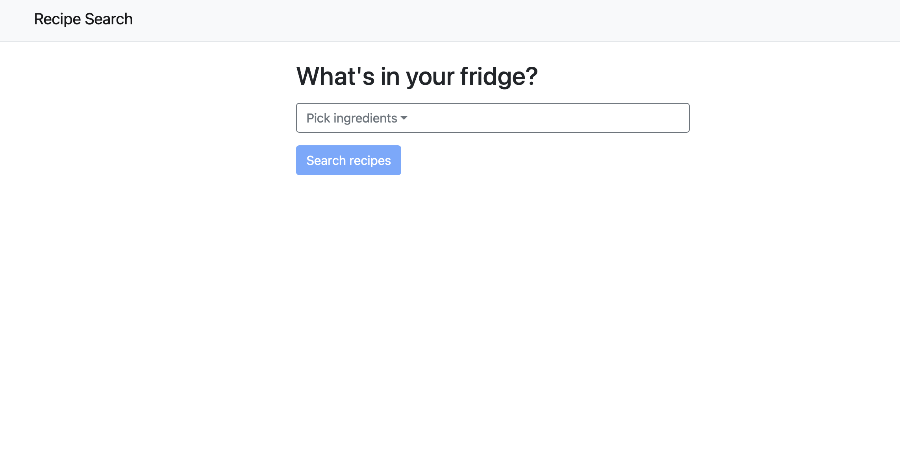
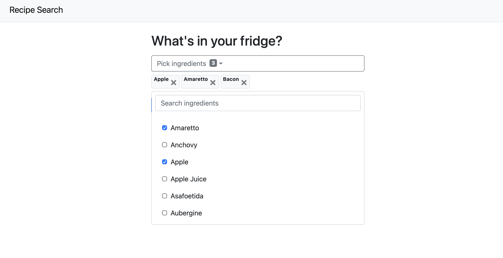
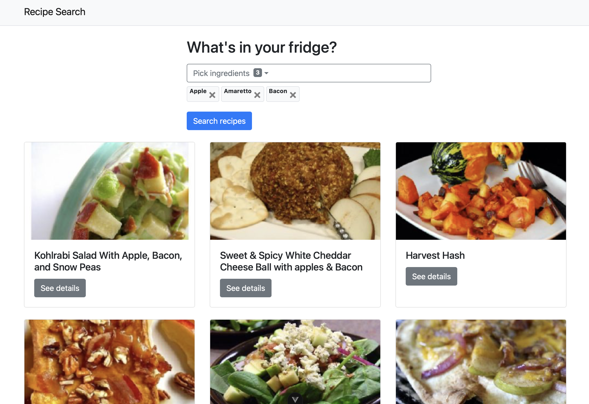
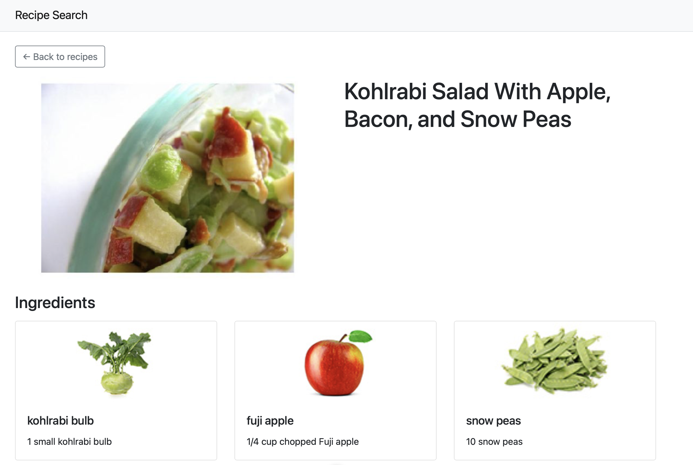

# Recipe Search

Search for recipes using ingredients you already have.

## Requirements

- Node.js `^22.18.0` or `>=24.12.0`
- npm
- A Spoonacular API key

## Setup

1. Install the dependencies:

   ```sh
   npm install
   ```

2. Create a `.env` file in the project root and add your Spoonacular API key:

   ```env
   VITE_recipe_API_key=your_api_key
   ```

   Keep the key private. The `.env` file is excluded from Git.

3. Start the development server:

   ```sh
   npm run dev
   ```

   Open the local URL printed in the terminal.

## Using the app

1. Open the website 

2. Select the ingredients you have at home

3. Select **Search recipes** and view the results

4. Select **See details** on a recipe to view its ingredients.

5. Use **Back to recipes** or the **Recipe Search** navbar link to return to the search page.

## Tech stack

- Vue 3
- Vite
- Vue Router
- Bootstrap 4
- Spoonacular API

## Other commands

```sh
npm run build    # Create a production build in dist/
npm run preview  # Preview the production build locally
npm run lint     # Run ESLint and Oxlint
```

## Sources used to make the project

- [W3Schools CSS reference](https://www.w3schools.com/css/default.asp)
- [Bootstrap 4 list groups](https://getbootstrap.com/docs/4.6/components/list-group/)
- [A beginner's guide to building a Vue 3 web application](https://medium.com/@mallikarjunpasupuleti/a-beginners-guide-to-building-your-first-web-application-in-vue-3-7faac4776e3b)
- [MDBootstrap searchable multiselect](https://mdbootstrap.com/docs/standard/extended/select-dropdown-with-search/#section-multiselect)
- [Recipes by A to Z list of ingredients](https://www.warrennash.co.uk/recipesbyatozlistofingredients#google_vignette)
- [Vue introduction](https://vuejs.org/guide/introduction.html)
- [CodePen multiselect example](https://codepen.io/wisnust10/pen/BKjNNR)
- [Vue component `v-model`](https://vuejs.org/guide/components/v-model.html)
- [Vue Router dynamic route matching](https://router.vuejs.org/guide/essentials/dynamic-matching)
- [Vue Router guide](https://router.vuejs.org/guide/)
